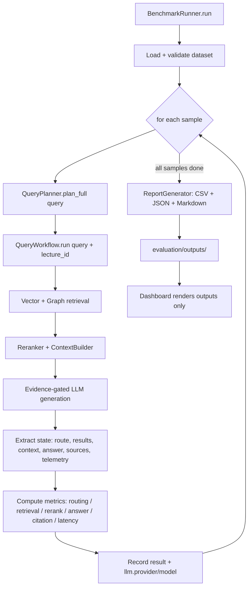

# EVALUATION.md

> **Purpose:** How LectureMIND is measured — dataset format, metric implementations, report generation, and the measured results.
> **Audience:** Engineers running benchmarks; interviewers checking the numbers behind the claims.
> **Last updated:** 2026-11-14 · reflects the current harness (pre- and post-rerank retrieval metrics, context recall, per-type/p95 reporting) and the current measured run (`evaluation/reports/smoke_groq_20261114_newcode/`, 45-question three-lecture smoke set). The earlier 50-question single-lecture run is kept as history in §6.3 and cannot be reproduced on the current packages.
> **Companion docs:** [METRICS_MATRIX.md](../METRICS_MATRIX.md) (scorecard) · [RETRIEVAL_SYSTEM.md](./RETRIEVAL_SYSTEM.md) (what is being measured)

---

## Table of Contents

- [1. Framework Overview](#1-framework-overview)
- [2. Benchmark Dataset Format](#2-benchmark-dataset-format)
- [3. Benchmark Execution Flow](#3-benchmark-execution-flow)
- [4. Metric Module Implementations](#4-metric-module-implementations)
- [5. Report Generation](#5-report-generation)
- [6. Measured Results (Conversational RAG)](#6-measured-results-conversational-rag)
- [7. Knowledge Graph Quality & Prerequisite Audit (Live Measured)](#7-knowledge-graph-quality--prerequisite-audit-live-measured)
- [8. Benchmark Invocation](#8-benchmark-invocation)

---

## 1. Framework Overview

LectureMIND includes a dedicated offline evaluation framework for measuring the quality of the entire RAG pipeline. It is completely **decoupled from the FastAPI layer** — it invokes `QueryWorkflow` directly as a Python object, bypassing HTTP entirely.

**Why decoupled?**
- The HTTP layer adds latency, serialization overhead, and streaming complexity that obscures intermediate pipeline state.
- Direct instantiation lets the benchmark runner inspect internal state (like `vector_results`, `reranked_results`, `telemetry`) that is never exposed via the API.
- This makes metric collection exact and deterministic.

**Primary Files:**
| File | Role |
|---|---|
| `evaluation/benchmark_runner.py` | Main orchestrator (injectable deps: Qdrant, embeddings, reranker, Neo4j, LLM) |
| `evaluation/dataset_loader.py` | Loads and validates the benchmark dataset |
| `evaluation/metrics/planner_metrics.py` | Routing accuracy (+ visual routing accuracy) |
| `evaluation/metrics/retrieval_metrics.py` | Precision, Recall, Hit, MRR, NDCG |
| `evaluation/metrics/reranker_metrics.py` | Ranking quality, cross-encoder scores |
| `evaluation/metrics/answer_metrics.py` | Answer similarity, answer F1, keyword recall, context/answer lengths |
| `evaluation/metrics/citation_metrics.py` | Citation coverage, completeness, chunk coverage |
| `evaluation/metrics/latency_metrics.py` | Per-node and total latency |
| `evaluation/reports/report_generator.py` | Aggregation (mean/p95/min/max/n + per-type/difficulty breakdowns) and output generation |
| `evaluation/datasets/multilecture_smoke_45.json` | Current 45-question smoke set (15 per lecture × 3 lectures; LLM-drafted, not human-reviewed) |
| `evaluation/datasets/cs162_lecture1_qa_50.json` | Historical 50-question CS162 set (labels no longer align with the loaded packages) |
| `evaluation/datasets/sample_dataset.json` | Minimal format example |
| `scripts/run_mlops_smoke.py` | Validate the smoke set; `--run` executes the live benchmark (uses LLM quota) |
| `scripts/compare_retrieval_run.py` / `scripts/compare_retrieval_analyze.py` | No-LLM retrieval comparison of two code versions on the same data |

---

## 2. Benchmark Dataset Format

**Files:** `evaluation/datasets/multilecture_smoke_45.json` (current, 45 questions) ·
`evaluation/datasets/cs162_lecture1_qa_50.json` (historical, 50 questions — example below)  \
**Schema:** Array of `BenchmarkSample` objects

```json
{
  "lecture_id": "lecture_cs162_v17",
  "query": "What is the Global Data Plane project?",
  "ground_truth_answer": "The Global Data Plane is a project looking at hardened data containers — cryptographically hardened containers of data...",
  "expected_chunk_ids": [
    "CS162_Lecture_1_What_is_an_Operating_System_720P_chunk_000053"
  ],
  "expected_route": "vector_only",
  "question_type": "definition",
  "difficulty": "easy",
  "topic": "what-is-an-os",
  "keywords": ["definition", "kernel", "vendor", "universally accepted"],
  "need_visual": false
}
```

| Field | Type | Used By |
|---|---|---|
| `lecture_id` | `str` | Scopes every workflow call (isolation guards apply) |
| `query` | `str` | All metrics — the question sent to the pipeline |
| `ground_truth_answer` | `str` | `answer_metrics.calculate_answer_similarity` / `calculate_answer_f1` |
| `expected_chunk_ids` | `list[str]` | `retrieval_metrics.*`, `reranker_metrics.*`, `citation_metrics.*` |
| `expected_route` | `str` | `planner_metrics.calculate_routing_accuracy` (must match `RetrievalRoute` **enum names**: `vector_only` / `graph_only` / `graph_and_vector`) |
| `question_type` | `str` | Report breakdowns (e.g. `factual`, `conceptual`, `definition`, `summary`, `relationship`, `visual`) |
| `difficulty` | `str` | Report breakdowns (`easy` / `medium` / `hard`) |
| `topic` | `str` | Optional labeling |
| `keywords` | `list[str]` | `answer_metrics.calculate_keyword_recall` — must contain terms the answer should reproduce |
| `need_visual` | `bool` | `visual_routing_accuracy` — whether the planner must set `need_visual` |

> **Ground-truth integrity:** the CS162 50-question set was keyword-verified against the
> package it was built on, which is no longer loaded; against the two current CS162 packages
> its gold chunks contain the question keywords for only 21/50 and 17/50 questions, so it is
> historical only. The current smoke set ties each LLM-drafted question to the chunk it was
> generated from (`source_evidence`); its labels are not human-reviewed.

---

## 3. Benchmark Execution Flow



**Entry:**
```python
from evaluation.benchmark_runner import BenchmarkRunner

runner = BenchmarkRunner(
    dataset_path="evaluation/datasets/cs162_lecture1_qa_50.json",
    output_dir="evaluation/outputs",
    # Optional injections: qdrant_client, embedding_model, reranker_service,
    # neo4j_driver, ollama_client, use_provider_registry_llm=True
)
runner.setup()
runner.run()
```

When a dependency is omitted the runner builds it from the live local stack
(Qdrant at `localhost:6333`, preloaded `bge-large-en-v1.5`, the global cross-encoder
from `GLOBAL_RERANKER_DIR`, and the active LLM backend via `ProviderRegistry`).
`use_provider_registry_llm=False` + `ollama_client=<client>` forces the local Ollama backend.

**Per-sample flow:**
```
BenchmarkRunner._evaluate_sample(sample)
    ├── plan = QueryPlanner().plan_full(sample.query)      # route + need_visual
    ├── state = QueryWorkflow.run(query, lecture_id)        # real pipeline
    ├── actual_route     = state["retrieval_route"].name    # enum NAME (graph_and_vector)
    ├── actual_need_visual = plan.need_visual
    ├── retrieved_ids    = chunk_ids from graph_results + vector_results
    ├── reranked_results / final_context / answer / sources / telemetry
    ├── compute metrics (Section 4)
    └── record result + llm provenance {provider, model}
```

---

## 4. Metric Module Implementations

### 4.1 Planner Metrics (`planner_metrics.py`)

- **`routing_accuracy`** — `1.0` if `expected_route == actual_route` (case-insensitive), else `0.0`.
  The runner normalizes the actual route to the enum **name** (`graph_and_vector`), so dataset
  values and runtime values share one vocabulary.
- **`visual_routing_accuracy`** — same binary comparison between the sample's `need_visual`
  and the planner's `plan_full().need_visual` (labels `need_visual` / `no_visual`).

### 4.2 Retrieval Metrics (`retrieval_metrics.py`)

Relevance is binary: a chunk is relevant iff its `chunk_id` is in `expected_chunk_ids`.
Two rankings are measured:

- **Post-rerank (primary):** `post_rerank_hit_at_5`, `post_rerank_recall_at_5`,
  `post_rerank_mrr_at_5`, `post_rerank_ndcg_at_5` on the cross-encoder order — what the
  context builder and generator actually receive.
- **`context_recall` (primary):** fraction of expected chunks that were placed in the LLM
  prompt after reranking, adjacent-chunk merging and the character budget.
- **Pre-rerank (legacy keys, below):** computed on the candidate pool before the cross-encoder
  — the dense results fused with BM25 via RRF (skipped for lecture-wide queries, using the
  same `should_apply_hybrid` rule as the runtime). Graph results carry no chunk IDs and do not
  contribute.

- `precision@5` — of the top-5 retrieved, the fraction that are relevant.
- `recall@5` — of all relevant chunks, the fraction in the top-5.
- `hit@5` — 1.0 if any relevant chunk appears in the top-5.
- `mrr_at_5` — reciprocal rank of the first relevant chunk, **capped at k=5** (a relevant chunk
  at rank > 5 contributes 0). This is the strict MRR@5 reported in headline tables.
- `mrr` — untruncated reciprocal rank of the first relevant chunk (diagnostic only; shows where
  relevant chunks rank beyond position 5).
- `ndcg_at_5` — position-weighted gain, normalized.

### 4.3 Reranker Metrics (`reranker_metrics.py`)

- **`ranking_quality`** — MRR of the **reranked** list against `expected_ids`.
- **`avg_cross_encoder_score`** — mean of `rerank_score` across reranked results
  (reads `rerank_score`, with a `score` fallback for legacy callers). Returns `0.0` on empty input.

### 4.4 Answer Metrics (`answer_metrics.py`)

- **`answer_similarity`** — Jaccard token overlap vs the ground truth (no semantic awareness).
- **`answer_f1`** — SQuAD-style token-level F1 vs the ground truth (more forgiving than Jaccard;
  rewards partial overlap, penalizes length mismatch; `0.0` if either side is empty).
- **`keyword_recall`** — fraction of `sample.keywords` found in the answer. Returns **`0.0`**
  on an empty keyword list (an empty list must never report perfect recall).
- `context_length` / `answer_length` — character counts.

### 4.5 Citation Metrics (`citation_metrics.py`)

`state["sources"]` is built from the chunks placed in the prompt; the LLM does not see
chunk IDs and does not choose citations. Read these metrics accordingly:

- `citation_count` — unique `chunk_id`s in `state["sources"]`.
- `citation_coverage` — fraction of expected chunks among the sources; equal to
  `context_recall`.
- `citation_provenance_precision` (alias `citation_completeness`) — fraction of sources that
  were in the prompt context. It is 1.0 by construction (sanity check, not a quality signal);
  claim-level faithfulness needs a judge-based evaluation.
- `chunk_coverage` — fraction of reranked candidates that reached the prompt.

### 4.6 Latency Metrics (`latency_metrics.py`)

Reads `state["telemetry"]` recorded by `workflow.py` with `time.perf_counter()` around each
stage: `planner_latency`, `retrieval_latency`, `reranker_latency`, `generation_latency`,
`total_latency`.

---

## 5. Report Generation

`evaluation/reports/report_generator.py` writes three files per run:

1. `evaluation_report_{timestamp}.csv` — one row per sample, all metrics as columns.
2. `evaluation_report_{timestamp}.json` — per-sample results + `aggregated_metrics`
   (`{mean, p95, min, max, n}` per metric) + `breakdowns` by `question_type` and `difficulty`
   + `total_samples` / `successful_samples` / `failed_samples`.
3. `evaluation_report_{timestamp}.md` — markdown tables of the aggregated metrics.

`p95` uses nearest-rank over the sorted per-sample values (with `n < 20`, p95 is close to the
second-worst value — read it with that caveat in mind).

---

## 6. Measured Results (Conversational RAG)

### 6.1 Current run — 45-question smoke set, reviewed labels (2026-11-14)

Source: `evaluation/reports/smoke_groq_20261114_reviewed/evaluation_report_20261114_171933.*`
(+ `analysis.md`: bootstrap CIs and error analysis from `scripts/analyze_benchmark.py`) —
45/45 questions, 0 failures, Groq `openai/gpt-oss-20b`, real `QueryWorkflow`.
Dataset: `evaluation/datasets/multilecture_smoke_45_reviewed.json` — the smoke set after an
**AI-assisted label review** (each question's gold chunk read against its reference answer):
3 reference answers corrected (ASR-misspelled instructor name, an answer that did not answer the
question, a layout description instead of a meaning), 25 missing supporting chunks added (45 → 70
gold chunks), 3 graph-fact questions flagged as weak chunk-level evidence. Every item records a
`review_note`. **Not human-reviewed**: `validate_benchmark --profile release` rejects it.

| Metric | Mean | 95% CI | n |
|---|---:|---:|---:|
| **Post-rerank Hit@5** | **0.907** | 0.814 – 0.977 | 43 |
| **Post-rerank MRR@5** | **0.801** | 0.691 – 0.903 | 43 |
| Post-rerank Recall@5 / nDCG@5 | 0.880 / 0.813 | — | 43 |
| **Context recall** | **0.843** | 0.736 – 0.936 | 43 |
| Pre-rerank Hit@5 / MRR@5 (RRF order) | 0.884 / 0.804 | — | 43 |
| Routing accuracy / visual routing accuracy | 0.933 / 0.911 | — | 45 |
| Answer token F1 (lexical) | 0.256 | 0.201 – 0.313 | 45 |
| Keyword recall | 0.786 | 0.682 – 0.878 | 45 |
| Correct refusals (unanswerable) | 2/2 | — | 2 |
| Answerable questions refused | 4/43 | — | 43 |
| Mean / p95 total latency | 27.5 s / 31.2 s | — | 45 |

**By question type (post-rerank):** factual (17) Hit@5 0.94 / MRR@5 0.83 / context recall 0.90 · conceptual (12) 0.92 / 0.86 / 0.92 · visual (10) 0.90 / 0.85 / 0.84 · definition (1) 1.00 / 1.00 / 1.00 · graph (3) 0.67 / 0.18 / 0.17.

**Component ablation** (`evaluation/reports/ablation_20261114_reviewed/`, no LLM):

| Configuration | Hit@1 | Hit@5 | MRR@5 | Context recall |
|---|---:|---:|---:|---:|
| Dense only | 0.674 | 0.814 | 0.734 | 0.793 |
| + BM25 (RRF) | 0.744 | 0.884 | 0.804 | 0.824 |
| + cross-encoder | 0.744 | 0.907 | 0.801 | 0.874 |
| + graph context (production) | 0.744 | 0.907 | 0.801 | 0.843 |
| Production, previous 4,000-char / 50%-graph budget | 0.744 | 0.907 | 0.801 | 0.783 |

**Error analysis** (43 answerable): 36 answered with the evidence in the prompt · 2 refused with the evidence in the prompt (visual questions not flagged `need_visual`) · 4 evidence retrieved but not placed in the prompt · 1 retrieval miss.

**What the numbers say:**
- BM25 is the largest single gain; the cross-encoder adds +0.023 Hit@5 and +0.05 context recall, with no MRR gain on this set.
- The graph layer does not change chunk ranking and costs prompt space (graph-routed context recall 0.750 → 0.528); its benefit for relational answers is not yet demonstrated.
- The 6,000-char / 25%-graph budget was chosen on this same set (no dev split), so its gain is optimistic; it raised Groq-paced latency from 21.8 s to 27.5 s.
- n = 43 gives ±0.1 confidence intervals; graph (3) and unanswerable (2) slices are too small for claims. No judge-based faithfulness metric has been run.

Earlier runs on the unreviewed labels (`smoke_groq_20261010_fixed/` with the old code,
`smoke_groq_20261114_newcode/` with the fixes but the 4,000-char budget) remain for traceability:
post-rerank Hit@5 0.884, MRR@5 0.759, context recall 0.767 on those labels.

### 6.2 Effect of the 2026-11 correctness fixes (no-LLM comparison)

Source: `evaluation/reports/retrieval_comparison_20261114/` (commit `891648c` vs. current
code, same data, same models, no LLM calls). The old-code run reproduces the stored
2026-10-10 report exactly (pre-rerank Hit@5 0.8605, MRR@5 0.7333, context recall 0.7674).

| | Before | After |
|---|---:|---:|
| Post-rerank Hit@5 / MRR@5 (43) | 0.8837 / 0.7593 | 0.8837 / 0.7593 |
| Context recall (43) | 0.7674 | 0.7674 |
| Routing accuracy (45) | 0.8889 | 0.9333 |
| Mean `[Graph]` lines in context (graph-routed questions) | 24.6 | 41.8 |
| Summary prompts: mean timeline span in context (9) | 0.807 | 0.872 |
| Summary prompts: worst timeline span | 0.464 | 0.863 |
| Summary prompts: lecture deciles covered (of 10) | 5.3 | 7.7 |

Per-question post-rerank MRR@5 is identical for all 43 answerable questions: the smoke set has
no lecture-wide, grading/syllabus or plural-"prerequisites" questions, and graph results add
relation lines rather than chunks. The 2026-11-14 Groq run (§6.1) matches the
2026-10-10 run on every retrieval metric; answer F1 moved 0.2667 → 0.2530 and keyword recall
0.7540 → 0.7733, within LLM run-to-run variation.

### 6.3 Historical — 50-question single-lecture run (2026-08-11)

Source: `evaluation/outputs/evaluation_report_20260811_105621.*` (Groq `openai/gpt-oss-120b`,
dataset `evaluation/datasets/cs162_lecture1_qa_50.json`). Reported then: Hit@5 0.980,
MRR@5 0.785, routing 0.980, answer F1 0.459, total latency 20.5 s.

This run is kept for traceability only. It **cannot be reproduced on the current packages**:
its `lecture_id` (`lecture_cs162_v17`) is not loaded, and its gold chunk IDs now point to
different text in both loaded CS162 packages (question keywords appear in the gold chunks
for only 21/50 and 17/50 questions). Several CS162-specific tuning decisions were also made
on this set, so it is not a held-out measurement.

---

## 7. Knowledge Graph Quality & Prerequisite Audit (Live Measured)

Audited via `evaluation/knowledge_graph/audit_package.py`. Reference labels (`evaluation/knowledge_graph/*_gold.json`) are **LLM-assisted labels pending human verification**, annotated for the 6.5-minute **Transformer lecture only** — the auditor computes gold metrics **only when the audited package matches that lecture** (`gold_applies` flag); for every other package gold metrics are reported as `null`, and the composite score counts only measurable components.

Regenerated audits (2026-09-15, honest one-to-one matching, no fallback substitution, computed from the **latest `0-output/` packages**):

> **Independence caveat:** these audits were produced while the entity/relation extraction prompts
> and the prerequisite rules contained the Transformer lecture's own entities and terms. Those were
> removed on 2026-11-14 (prompts now use neutral examples; a test asserts no gold entity appears
> in them). The Transformer gold scores are therefore not an independent measurement; re-extraction
> is required for one. Removing the rules left the prerequisite output of the three benchmark
> lectures unchanged (27 / 15 / 14 edges, identical).

| Package | Entity F1 | Relation F1 | Prereq F1 | DAG / cycles | Prereq edges | Composite |
|---|---|---|---|---|---|---|
| Transformer (gold applies) | **40.0%** (P 55.6 / R 31.3) | **0.0%** (0/5) | **0.0%** (0/3) | True / 0 | 3 | 32.1 / 100 |
| CS162 (98 chunks) | n/a | n/a | n/a | True / 0 | 29 | **37.4 / 55** |
| MIT 6.S191 (70 chunks) | n/a | n/a | n/a | True / 0 | 15 | **25.0 / 45** |
| Self-Attention (48 chunks) | n/a | n/a | n/a | True / 0 | 14 | **27.2 / 45** |

All four audits were computed from the current packages in `0-output/` (the CS162 package is verified with 98 chunks, and all routing and QA benchmark anchor chunk IDs verify against that package).

Structural properties measured across all audited packages (gold-independent): the inferred prerequisite set is a strict DAG (0 cycles, 0 self-loops), 0.0% dangling relations. This guarantee covers the inferred set only: A9-extracted PREREQUISITE_OF edges share the edge type and their union with it can contain cycles (e.g. Operating System → System → Operating System on CS162), which the Back-Tracker excludes at query time. CS162 additionally has 29/29 pedagogically supported prerequisites.

Historical audit of the (no-longer-preserved) original benchmark package, retained for traceability:

| Metric | Measured Score | Diagnostic Context |
|---|---|---|
| **Prerequisite Strict Precision** | 77.8% (7/9) | Strict 1-to-1 exact matching against gold labels |
| **Prerequisite Strict Recall** | 70.0% (7/10) | 100% of valid pedagogical dependencies recovered |
| **Prerequisite Strict F1** | 73.7% | Historical baseline comparison (+12.8% absolute gain) |
| **Graph Topology (Strict DAG)** | **True** | Deterministic DFS cycle resolution guarantees acyclicity |
| **Cycle Count** | **0** | Zero feedback loops in prerequisite graph |
| **Self-Loop Count** | **0** | Zero self-dependencies ($A \to A$) |
| **Pedagogical Relevance Rate** | **100%** | Zero physical components/losses mislabeled as prerequisites |
| **Dangling Relation Rate** | **0.0%** | 100% referential integrity across all extracted entities |

### Multi-Lecture Extraction Yield (Full Cloud Execution)

Empirical extraction yield across three complete production lecture packages in `0-output/` using sliding-window chunking, compact entity alias remapping (`E1, E2...`), and 8192-token retry budgets:

| Lecture Package | Duration / Chunks | Extracted Entities | Extracted Relations | Inferred Prerequisites | DAG Status | Package Size |
|---|---|---|---|---|---|---|
| **CS162 Operating Systems** | ~83 min (98 chunks) | **158** | **103** | **29** | **Strict DAG (0 cycles)** | **437 KB** |
| **MIT 6.S191 Deep Learning** | ~56 min (70 chunks) | **87** | **94** | **15** | **Strict DAG (0 cycles)** | **312 KB** |
| **Self-Attention in Transformers**| ~44 min (48 chunks) | **82** | **65** | **14** | **Strict DAG (0 cycles)** | **208 KB** |
| **Total Across Corpus** | **216 chunks** | **327 entities** | **262 relations** | **58 prerequisites** | **100% Acyclic** | **957 KB total** |

### Downstream GraphRAG Benchmark Evaluation (CS162)

Evaluated via `evaluation/knowledge_graph/graphrag_evaluator.py`:

| Retrieval Route | Hit@1 | Hit@3 | Hit@5 | Recall@5 | Precision@5 | MRR |
| :--- | :---: | :---: | :---: | :---: | :---: | :---: |
| **BM25 / Lexical Retrieval** | 0.25 | 0.42 | 0.50 | 0.403 | 0.117 | 0.389 |
| **Graph-Only RAG** | 0.08 | 0.42 | 0.42 | 0.236 | 0.100 | 0.280 |
| **Hybrid RAG (RRF)** | **0.25** | **0.42** | **0.67** | **0.486** | **0.167** | **0.420** |

---

### Held-Out GraphRAG Evaluation (CS162, 30 questions)

Source: `evaluation/outputs/graph_heldout_evaluation.{json,md}` (run 2026-09-25 on the
pre-fix code; the Markdown report is now generated from the JSON, with no hard-coded values).
This evaluator uses `SimpleBM25` + `SimpleGraphRetriever` and a top-3-chunk prompt — it does
**not** run dense retrieval, the cross-encoder or `ContextBuilder`.

| Metric | Result |
|---|---:|
| Structural path recovery (answerable, direction ignored) | 13/25 (52.0%) — 1-hop 4/8, 2-hop 7/10, 3-hop 2/7 |
| Hybrid (graph + BM25 RRF) chunk Hit@5 | 0.840 — 1-hop 5/8, 2-hop 10/10, 3-hop 6/7 |
| Hybrid vs. BM25 alone | Hit@5 +20.0 pts, **Hit@1 −24.0 pts, MRR −9.8 pts** |
| Negative refusals | 5/5 |
| False-positive path rate (negatives) | 1/5 |
| Lenient answer match (keyword recall ≥ 0.5 or F1 ≥ 0.25) | 25/30; 9 of 20 answerable matches passed on keyword recall alone |

Rerunning it after the graph-direction fix requires deleting
`evaluation/outputs/graph_heldout_checkpoint.json` (cached answers) and uses ~30 LLM calls.

> **Package note:** the CS162 knowledge-graph counts in this section (98 chunks, 158 entities,
> 103 relations) describe package `lecture_05086e79`. The QA and held-out benchmarks use
> `lecture_092f861b` (93 chunks, 138 entities, 189 relations). "Strict DAG / 0 cycles /
> 0 dangling relations" are guaranteed by the DFS cycle breaker and loader validation — they
> confirm the constraints run, not extraction quality.

## 8. Benchmark Invocation

### 8.1 Running Knowledge Graph Quality & Prerequisite Audit
Audit any Knowledge Package ZIP:
```bash
./.venv/bin/python evaluation/knowledge_graph/audit_package.py \
  --package 0-output/CS162_Lecture_1_What_is_an_Operating_System_720P_knowledge_package.zip \
  --output-dir outputs/kg_quality_cs162/
```

### 8.2 Running Conversational RAG Benchmark
```bash
# Validate the smoke set and refresh the dashboard (no LLM calls):
./.venv_clean/bin/python scripts/run_mlops_smoke.py

# Run the live benchmark (uses LLM provider quota); write to a new folder per run:
./.venv_clean/bin/python scripts/run_mlops_smoke.py --run \
  --output-dir evaluation/reports/smoke_<provider>_<YYYYMMDD>
```

Requires Qdrant and Neo4j (`docker compose -f local/docker/docker-compose.yml up -d qdrant neo4j`),
the `bge-large-en-v1.5` embedding model (downloaded on first use, ~1.3 GB) and the reranker in
`local_runtime/models/global_reranker/`. The dashboard (`evaluation/dashboard/index.html`) is
rendered from the selected output folder.

### 8.3 Comparing two code versions without LLM calls
```bash
git worktree add --detach /tmp/old_tree <commit> && cp .env /tmp/old_tree/
./.venv_clean/bin/python scripts/compare_retrieval_run.py /tmp/old_tree evaluation/datasets/multilecture_smoke_45.json old.jsonl
./.venv_clean/bin/python scripts/compare_retrieval_run.py . evaluation/datasets/multilecture_smoke_45.json new.jsonl
./.venv_clean/bin/python scripts/compare_retrieval_analyze.py old.jsonl new.jsonl comparison.json
```

### 8.4 Ablation, confidence intervals and error analysis (no LLM calls)
```bash
# Component ablation + context-budget variants (dense / +BM25 / +reranker / +graph):
./.venv_clean/bin/python scripts/run_ablation.py \
  --dataset evaluation/datasets/multilecture_smoke_45_reviewed.json --out-dir evaluation/reports/ablation_<date>

# Bootstrap 95% CIs + per-question error analysis for a benchmark report:
./.venv_clean/bin/python scripts/analyze_benchmark.py \
  --report evaluation/reports/<run>/evaluation_report_<ts>.json \
  --ablation evaluation/reports/ablation_<date>/per_question.jsonl \
  --out evaluation/reports/<run>/analysis.md
```
